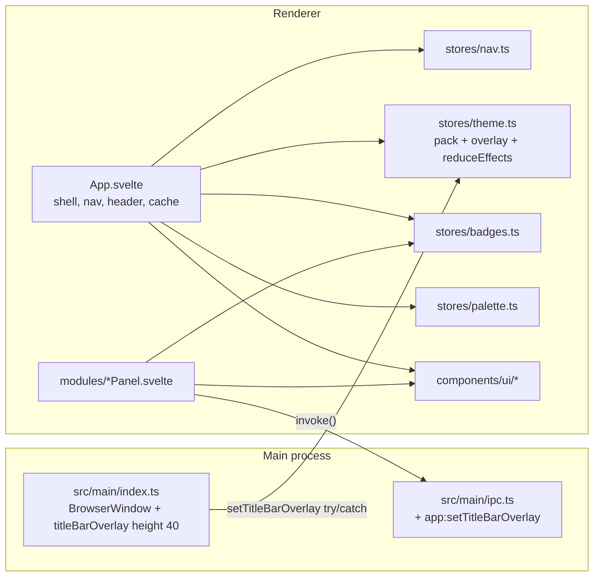
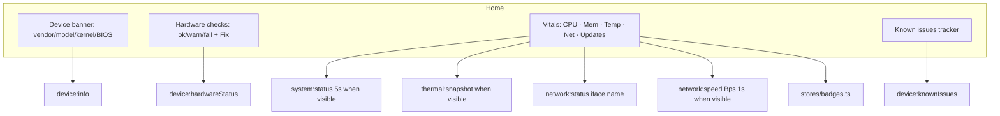

# Linux Command Centre — UX/UI/Styling Overhaul

| Field | Value |
|---|---|
| **Author** | Shane |
| **Date** | 2026-09-01 |
| **Status** | Draft |
| **Scope** | Renderer chrome, design system, theming, accessibility, and panel UX. Privileged IPC, helper, and module data sources stay as they are except tiny glue (prefs keys, title-bar overlay colour, optional hash). |
| **Stack** | Electron 33 · Svelte 5 (runes) · Tailwind 3.4 · lucide-svelte 0.460 · bits-ui 1.8 (present, unused) |

---

## Overview

Linux Command Centre is a 41-panel system-management dashboard switched from a 208 px sidebar in `src/renderer/src/App.svelte`. Shared UI is four files (`Alert.svelte`, `Spinner.svelte`, `Toaster.svelte`, `CommandPalette.svelte`); `src/renderer/src/components/ui/` is empty; `cn()` and `bits-ui` are unused. The chrome does not scale (five groups, Hardware has 14 items), labels collide (“System” and “Network” are both a group and a panel), the header fights Linux window-control overlay, and every panel re-implements toggles, dialogs, widths, loading, and confirms.

This design replaces ad-hoc panel chrome with a small Svelte 5 design system (bits-ui for Dialog, Select, Switch, and filterable Listbox/Combobox; local APG combobox for the palette; local wrappers for the rest), a navigable sidebar with search/pins/recents, a real **Home** dashboard built from Device health + system vitals, two content widths, one save-model rule, one confirm dialog, tokenised status colour, a Light pack, and an incremental PR sequence that is independently mergeable.

No CSS framework is added. No IPC rewrite. Target window remains 1100×760, min 800×600.

PR order is **tokens → primitives → shell → Home → layout contract → chrome a11y → panel clusters**. Tokens land first so later PRs never introduce new `text-green-400`. Home does not ship in the same PR as Dialog. There is no leftover-polish dump; every module is in the [Panel migration matrix](#panel-migration-matrix).

---

## Background & Motivation

### Current state

- **Shell.** Custom title bar (`titleBarStyle: 'hidden'`, `titleBarOverlay` height 40, colour `#0f0f12`) in `src/main/index.ts`. In-app header is `h-11` (44 px). `nativeTheme.themeSource = 'dark'` is forced even though Appearance can set GNOME `prefer-light`.
- **Nav.** 5 groups × 41 modules, always expanded, no search, no collapse, no recents, no last-panel restore. Active module is `$state('system')` in memory only (`localStorage` is used solely for `lcc-theme`).
- **Remount.** `{#key active}` around `<current.component />` (`App.svelte` 258–260) destroys live graphs, process filters, log queries, and scroll position on every switch.
- **Tokens.** `:root` plus four `data-theme` packs in `src/renderer/src/app.css`. `--status-ok|warn|fail` exist but panels hardcode `text-green-400` / `yellow-400` / `red-400` (**135+** hits). `--destructive` has no `foreground` (Processes already uses `text-destructive-foreground`). `--font-sans` lists Inter / JetBrains Mono; neither is loaded. Scrollbar hover is `hsl(220 9% 32%)`. Sidebar hover is `hover:bg-white/[0.04]`.
- **Interaction.** ~17 copy-pasted `w-11 h-6` toggle pills, all `aria-label="Toggle X"` with no `role="switch"`. Confirms are a mix of native `confirm()` (Wi-Fi forget, `WifiPanel.svelte:85`), inline destructive strips (Users, Firewall, Bluetooth), a custom modal (Processes — copy can mention SIGKILL, button always sends `signal: 'TERM'` at line 241), and no confirm at all (sudo toggle, stop service). Toasts exist in 9 panels; Wi-Fi / Bluetooth / Hosts / DNS / GRUB / Device only set an error string.
- **Layout.** `max-w-sm` through `max-w-3xl` with no rule. Bluetooth, Power, Accessibility, Locale, Notifications are 24 rem wide in a 900 px pane. Logs nests `main overflow-y-auto` with `max-h-[calc(100vh-220px)]` (`LogsPanel.svelte:206`).
- **A11y.** Command palette is a `<div>` + backdrop `<button>` with no `role="dialog"`, no combobox pattern, no focus trap. `<main>` has no `<h1>`. Nav items are `<button>`s with no `aria-current`. Group labels are `text-[9.5px] text-muted-foreground/40`. AccessibilityPanel types `largeText` from GNOME `text-scaling-factor > 1.0` but **renders no such row**; `accessibility:set` does not handle `largeText`. GNOME text scale is the Appearance slider.

### Pain points this overhaul addresses

1. Finding a module among 41 items requires scrolling a 208 px list.
2. “System” and “Network” mean two different things depending on whether you are looking at a group header or a row.
3. Device health — the thing you open the app for — is the last item in Hardware.
4. Switching panels resets state; staying on a panel is the only way to keep a sparkline.
5. Linux window controls sit on top of the Sparkles button and the `⌃K` chip.
6. Visual language is inconsistent enough that each new panel invents another confirm, width, and loading treatment.

---

## Goals & Non-Goals

### Goals

- Make 41 modules findable: collapsible groups, sidebar search, pins + recents, last-panel restore, command-palette aliases.
- Promote Device health + live vitals as the Home screen; split the current System dump.
- Ship a used design system in `src/renderer/src/components/ui/` with frozen TypeScript props (Page, Card, Toggle, Button, Dialog, ConfirmDialog, SearchField, SegmentedControl, EmptyState, Skeleton, Listbox).
- One save-model rule, one confirm primitive, toasts on privileged success/error, skeletons instead of full-panel `Spinner`.
- Floor type at 13 px body / 11 px labels **in chrome**; map status to `--status-*`; load Inter and JetBrains Mono; add a Light pack; honour `prefers-reduced-motion` and a “Reduce effects” switch without killing `animate-spin`.
- WCAG 2.2 AA for chrome and controls: switches, focus trap, contrast, labelled icon buttons, combobox palette.
- Independently mergeable PRs in the order: **tokens → primitives → shell → Home → layout contract → chrome a11y → one PR per panel cluster**. Every module is assigned; no leftover dump.

### Non-Goals

- Rewriting `src/main/ipc.ts`, the privileged helper, stream server, or hardware profiles, except `app:setTitleBarOverlay` (colour + `nativeTheme` only; overlay **height stays 40**).
- New main-process prefs file. Renderer `localStorage` is enough. Light users accept a one-frame dark OS frame (see Overlay).
- Adding a CSS framework (no shadcn CLI, no DaisyUI, no Uno).
- Icon-rail / dual-sidebar / activity-bar redesign.
- i18n / localisation of UI strings.
- Changing GNOME itself beyond what Appearance / Accessibility already write via `gsettings`.
- A duplicate “Large Text” switch on the Accessibility panel (the control does not exist; GNOME scale stays on Appearance).
- Mobile / small-phone layouts. Floor is 800×600 at 100% UI scale.
- Visual regression screenshots in CI (manual Electron verification; see Rollout).
- bits-ui Command (cmdk). Palette is a local APG combobox.

---

## Key Decisions

1. **Home is a new module (`id: 'home'`), Device leaves the sidebar.** Home composes `device:info` / `device:hardwareStatus` / `device:knownIssues` plus a vitals strip from `system:status`, `thermal:snapshot`, `network:status` (iface name) + `network:speed` (Bps), and `badge:counts` via `stores/badges.ts`. Rationale: one place for “is this machine OK?”, no duplicate nav item.

2. **Exact label fixes.** Group **System** → **Settings**. Panel **System** → **System info** (`id` stays `'system'`). Panel **Network** → **Interfaces** (`id` stays `'network'`). Group **Network** stays **Network**. Rationale: ids are persistence/hash keys; labels are what humans collide on.

3. **Theme has one entry point: Appearance.** Remove the unlabeled Sparkles cycle button from the header. Appearance already has a labelled picker (`AppearancePanel.svelte` 90–121). Header keeps a single search affordance: a clickable `Ctrl+K` chip. First-run sidebar collapses **Hardware only** (not Settings), so Appearance stays visible. Keywords on Appearance include `theme, gtk, wallpaper, light`.

4. **Keep custom title bar; pad for overlay in JS.** Do not revert to a native title bar. Overlay **height stays 40 px** forever (see Decision 13). CSS `--wco-right: 140px` is the default **until** `getTitlebarAreaRect()` succeeds; after measure, **0 is allowed** (left-side buttons). Listen with `overlay.addEventListener('geometrychange', syncWco)` — not `overlay?.('geometrychange')`. `env(titlebar-area-*)` is additive, never the sole pad. Pad the **sidebar brand row** when `titlebar-area-x > 0`. Overlay colour + `nativeTheme` follow `OVERLAY[id].source` (`'light' | 'dark'`), not a hex equality. try/catch around `setTitleBarOverlay`.

5. **Drop `{#key active}` for a paused instance cache.** Markup: `{#each cache as id (id)}<div hidden={active !== id} inert={active !== id}><Comp visible={active === id} /></div>{/each}`. No `class="contents"` (conflicts with `hidden`). No `<svelte:component>` (deprecated in Svelte 5). Cache set and eviction: see [Pins, recents, cache](#pins-recents-cache). Hidden panels receive `visible=false` and **must pause intervals**; only the active panel polls.

6. **bits-ui for Dialog, Select, Switch, and filterable Listbox (Combobox); palette is local APG combobox; no ContextMenu.** bits-ui 1.8 is already in the lockfile. `Listbox` with `filterable: false` wraps bits-ui **Select**; `filterable: true` wraps bits-ui **Combobox** (search field + list — locales, GTK themes, timezones, log units). That Combobox is not the command palette. Command (cmdk) is not used — the APG role tree is already specified and we need keyword ranking the Command primitive does not give us. Pin is a **hover/focus pin icon** on the row, not a context menu. If a bits-ui wrapper fights Tailwind tokens, implement that one primitive locally; do not leave the dep unused.

7. **Two content widths only.** `narrow` = `max-w-lg` (32rem) for settings rows. `wide` = full main pane for lists, logs, tables, identity. Full 41-row map is in [Content widths](#content-widths). Mouse and Keyboard shrink from `max-w-xl` (36rem) to 32rem on purpose.

8. **Save-model rule.** Instant for a single toggle, slider, or enumerated choice. Explicit Save/Apply only when the write is a multi-field form or a file (`/etc/hosts`, crontab, GRUB, DNS, proxy bundle). Appearance GNOME controls become instant per key (`appearance:set` already accepts partial `opts`). Mouse / Keyboard become instant (slider debounce 150 ms).

9. **Prefs live in renderer `localStorage`, not main.** Keys: `lcc-theme` (existing), `lcc-nav`, `lcc-reduce-effects`, `lcc-ui-scale`. Hash `#<moduleId>` overrides stored last-module on launch. Hash is navigation only; middle-click does not open a window (`setWindowOpenHandler` already denies).

10. **Light is an explicit pack.** `ThemeId` includes `'light'`. `nativeTheme.themeSource` follows the pack. Do **not** auto-bind to GNOME `color-scheme`. First paint of `:root` is the current dark default so we do not flash light-on-dark. The **OS frame** is compiled as `#0f0f12`; Light users see a one-frame dark frame. **Accepted.** We will not add a userData JSON file in this overhaul.

11. **One effects boolean.** `reduceEffects = userFlag || osPrefersReducedMotion`. That boolean sets `html[data-reduce-effects]` (gates `--bg-image` and glows) **and** is the motion switch. Appearance checkbox is disabled when the OS forces it, labelled “Required by the desktop (Reduce animations)”. Do **not** set `animation-duration: 0.01ms` on `*`. `RefreshCw` `animate-spin` always runs. Skeleton uses `motion-safe:animate-pulse`.

12. **Sysctl stays in-app but off the dashboard.** Two keys move to a collapsed **Advanced** disclosure on System info. Package health moves to Updates. AI diagnostics collapse at the bottom of System info, not Home.

13. **UI scale is option A: zoom the panel body + in-pane dialogs.** Chrome (sidebar `w-52`, header `h-11`, 13/11 px type, overlay height 40, **command palette, Toaster**) **does not scale**. A `.page-zoom { zoom: var(--ui-scale); }` wrapper around `.page-body` **and** `#lcc-overlay-root` scales panel px **and** Dialog/ConfirmDialog (portaled into that root, not `document.body`). Palette and Toaster stay on `document.body` at 100% — they are chrome. `--ui-scale: 1 | 1.1 | 1.25 | 1.5`. Overlay collision cannot return. At 800×600 × 150% the pane simply scrolls. `text-sm` (14px) is **out of policy**. Do not express chrome in rem to “make html font-size work”.

14. **Default page-body scrolls; Logs is the only fill page.** `page-body` is `flex-1 min-h-0 overflow-y-auto p-5`. A shell flag `fill` (driven by `active === 'logs'`) switches that to `overflow-hidden px-5 pt-5 pb-0`. `Page` `fill` makes the page a column flex so Logs owns the inner scroller. System info, Users, Services keep the shell scroller.

15. **GRUB auto-loads; SMART `smart:info` is gated; Firewall remains the auth EmptyState reference.** `grub:status` is an unprivileged read — do not copy Firewall’s authenticate-to-load onto it. EmptyState on GRUB only if that read fails. SMART lists disks immediately (`smart:disks` / `lsblk`); each disk has “Load disk health” before `smart:info` (privileged).

---

## Proposed Design

### Architecture



### Information architecture

#### Group / panel labels (exact)

| Location | Today | After |
|---|---|---|
| Group | Overview | Overview |
| Panel | System | **System info** (`id: 'system'`) |
| New panel | — | **Home** (`id: 'home'`, default) |
| Group | Network | Network |
| Panel | Network | **Interfaces** (`id: 'network'`) |
| Group | Hardware | Hardware |
| Panel | Device | **Removed from nav** (content lives on Home) |
| Group | System | **Settings** |
| Panel | DNS | DNS (icon change only) |
| Group | Tools | Tools |

Overview after change: **Home**, **System info**, **Processes**. Hardware loses Device (13 items). Total modules: 41.

#### Sidebar behaviour

```ts
type NavPrefs = {
  last: string          // module id
  collapsed: string[]   // group labels
  pins: string[]        // max 6
  recents: string[]     // last 5 unique ids, never including pins
}
```

First-run defaults:

- `last = 'home'` (after PR 4; `'system'` until Home exists)
- `collapsed = ['Hardware']` — Settings stays open so Appearance / theme is findable without Sparkles
- `pins = []`, `recents = []`

**Search.** `SearchField` at the top of `<nav>` filters by `label`, `group`, and `keywords[]`. Filtering ignores collapse. Empty query restores collapse state.

**Keywords** (palette uses the same list). Exact alias match ranks above substring.

| id | keywords |
|---|---|
| updates | apt, dpkg, upgrade, unattended |
| logs | dmesg, journal, journalctl, syslog |
| firewall | ufw, iptables, nft |
| network | nmcli, ip, ifconfig, interfaces, nic |
| wifi | nmcli, ssid, wireless |
| processes | htop, top, ps, kill |
| services | systemd, systemctl, unit |
| ssh | sshd, keys |
| crontab | cron, at |
| grub | boot, grub, kernel cmdline |
| dns | resolv, systemd-resolved, nameserver |
| home | hostname, health, overview, device |
| system | specs, sysctl, lscpu, dmidecode |
| users | sudo, passwd, adduser |
| appearance | theme, gtk, wallpaper, light, dark, icons, cursor |
| accessibility | a11y, contrast, orca, magnifier |
| power | tuned, ppd, lid, idle |

#### Pins, recents, cache

| Knob | Value | Notes |
|---|---|---|
| Pin max | 6 | Hover/focus pin **icon** on the row (`aria-label="Pin {label}"`). No context menu. Sixth+ pin toasts “Unpin one first”. |
| Recents stored | 5 | Unique ids, **excluding pins**, most-recent first. Written on every `active` change. |
| Recents rendered | those 5 | Virtual group above labelled groups, only when non-empty. |
| Cache set | `uniq(['home', active, ...pins, ...recents])` | Worst case 13 mounted instances. Fine; they are paused. |
| Never evict | `{home, active}` | Home’s 60-sample sparkline survives six pins. |
| Other eviction | unpinned LRU = drop from recents | Pins stay in cache until unpinned. |
| Polling | **only `visible === true`** | `$effect` starts/stops `setInterval`. `onDestroy` still clears. |
| Markup | `hidden` + `inert` | Not tabbable. No `display: contents`. |
| `aria-current` | canonical group row only | Pinned/Recent shortcuts are extra `<a href="#{id}">` **without** `aria-current`, so only one current page. Keyboard: SearchField → Pinned links → Recents links → group headers → group links; pin icon is a sibling button after each group link (`focus-within` reveals it). |

Hash: `location.hash = '#' + id` on change; launch prefers hash over `last`. `<a href="#{id}">` `onclick` preventDefault + store set. Middle-click hits `setWindowOpenHandler` deny — **hash only, no new windows**. Hash does not change `document.title` (`index.html` title stays “Linux Command Centre”).

`stores/nav.ts` owns `active`. Do not keep a second `let active = $state('system')`.

#### Collapsible groups

Each group header is a `<button>` with `aria-expanded`, chevron, 11 px uppercase label. Click toggles `collapsed`. Search-forced visibility does not write `collapsed`.

#### DNS icon

Replace `Dna` (`App.svelte` line 77) with lucide **`Globe2`** (`lucide-svelte/dist/aliases` re-exports it in 0.460.1). Proxy keeps `Globe`. No inline SVG fallback.

#### Header chrome

```
[ icon ] [ <h1> current.label ]          [ Ctrl+K chip ]
                                         ↑ padding-right: var(--wco-right)
```

- Shell `<h1>` is the page title. Panels do not repeat it.
- `⌃K` is a `<button aria-label="Open command palette" aria-keyshortcuts="Control+K">`.
- Sparkles / `cycleTheme()` deleted.
- **Page actions stay in the Page toolbar, not the drag header.** Network’s `justify-end` refresh moves there.

#### Window-control overlay

Linux overlay is 40 px and **stays 40 px** (UI scale does not change it). Header is `h-11` (44 px).

```css
:root {
  --wco-right: 140px; /* required default until JS measures */
  --wco-left: 0px;
}
.app-header {
  height: 2.75rem; /* 44px; not rem-tied to ui-scale */
  padding-right: max(0.75rem, var(--wco-right));
}
.sidebar-brand {
  padding-left: max(1rem, var(--wco-left));
}
```

`:root { --wco-right: 140px }` is the **stylesheet default only**, used when the JS API is missing (`getTitlebarAreaRect` absent) or before the first successful measure. After a measure, **0 is valid** (GNOME buttons on the left → no right inset). Never coerce `0` to `140`.

```ts
function syncWco(): void {
  const overlay = navigator.windowControlsOverlay
  if (!overlay?.getTitlebarAreaRect) return // leave CSS default 140px
  const r = overlay.getTitlebarAreaRect()
  const right = Math.max(0, window.innerWidth - r.x - r.width)
  const left = Math.max(0, r.x)
  document.documentElement.style.setProperty('--wco-right', `${right}px`) // allow 0
  document.documentElement.style.setProperty('--wco-left', `${left}px`)
}

onMount(() => {
  syncWco()
  const overlay = navigator.windowControlsOverlay
  overlay?.addEventListener('geometrychange', syncWco)
  return () => overlay?.removeEventListener('geometrychange', syncWco)
})
```

There is no `overlay?.('geometrychange')` API. Verify Ubuntu **Wayland and X11**, window buttons **left and right**. At 800×600 with left-side buttons, `--wco-right: 0px` so `padding-right` falls back to `0.75rem` via `max()`, not 140 px.

Overlay colour: see Tokens. `theme.subscribe` calls `electronAPI.setTitleBarOverlay` in try/catch (`setTitleBarOverlay` can throw). Light pack also sets `nativeTheme.themeSource = 'light'` via the same handler.

**FOUC:** `createWindow` `backgroundColor: '#0f0f12'` is compile-time. Main cannot read renderer `localStorage`. Light users get a dark frame for one paint. **Accepted** (Non-Goals: no userData prefs file).

#### Command palette

**Local APG combobox** in `CommandPalette.svelte`. Not bits-ui Combobox, not bits-ui Command.

- Container: `role="dialog"` `aria-modal="true"` `aria-label="Command palette"`.
- Focus trap; initial focus on the input; Tab cycles inside; Escape closes and returns focus to the `⌃K` button (or previously focused element).
- Input: `role="combobox"` `aria-expanded="true"` `aria-controls="palette-listbox"` `aria-activedescendant="palette-opt-{id}"` `autocomplete="off"`.
- List: `role="listbox"`; each result `role="option"` `id="palette-opt-{id}"` `aria-selected`.
- Backdrop is `div` `aria-hidden="true"`. Click-to-dismiss stays.
- Filter: label, group, keywords. Exact alias ranks above substring.
- Footer hint 11 px minimum.

`stores/palette.ts` exposes `openPalette()` for the header chip.

#### Landmarks

```html
<div class="flex h-screen ...">
  <aside>
    <div class="sidebar-brand drag-region">Command Centre</div>
    <nav aria-label="Modules">
      <SearchField />
      <ul><!-- Pinned, Recent, then groups as nested lists --></ul>
    </nav>
  </aside>
  <main class="flex-1 flex flex-col overflow-hidden">
    <header class="app-header drag-region shrink-0">
      <h1 class="no-drag">{current.label}</h1>
      <button class="no-drag" aria-keyshortcuts="Control+K">Ctrl+K</button>
    </header>
    <div class="page-zoom flex-1 min-h-0 flex flex-col relative" style="zoom: var(--ui-scale, 1)">
      <div class="page-body flex-1 min-h-0 overflow-y-auto p-5">
        <!-- cache of panels; see below -->
      </div>
      <!-- Dialog / ConfirmDialog portal target (zoomed). Palette + Toaster stay on document.body. -->
      <div id="lcc-overlay-root" class="absolute inset-0 pointer-events-none z-50"></div>
    </div>
  </main>
</div>
```

When `active === 'logs'`, `page-body` classes become `flex-1 min-h-0 overflow-hidden px-5 pt-5 pb-0` (fill). Checklist for the chrome PR: **System info still scrolls at 800×600**.

#### Drop `{#key active}`

```svelte
{#each cache as id (id)}
  {@const Comp = componentById.get(id)}
  <div hidden={active !== id} inert={active !== id}>
    <Comp visible={active === id} />
  </div>
{/each}
```

Live panels accept `visible = true` and gate intervals:

```ts
let { visible = true }: { visible?: boolean } = $props()
$effect(() => {
  if (!visible) { clearInterval(interval); interval = undefined; return }
  if (!interval) interval = setInterval(() => load(true, true), 4000)
})
```

**Must pause in PR 3** (already mounted after the cache lands; today `{#key}` destroys them): System info (`5s`), Processes (`4s`), Interfaces (`network:speed` `1s` + 500 ms sample), Logs live (`3s`), Date & Time (`clockInterval` `1s` at `DateTimePanel.svelte:72`). **Must pause in PR 4:** Home (`system:status` `5s`, `network:speed` `1s`, `thermal:snapshot`). Hidden instances keep sparkline buffers and filter state; they do not hit IPC. Non-live panels declare `visible?: boolean` and ignore it so `<Comp visible={…} />` typechecks.

### Home dashboard

New `src/renderer/src/modules/home/HomePanel.svelte`. Default `active` after PR 4. Wide width. Move DevicePanel implementation here; delete the Hardware nav entry (file may remain as a re-export for one PR, then go).

`HomePanel` **declares `visible?: boolean`** and gates vitals polls with the same `$effect` as PR 3 live panels: `system:status` every 5 s, `thermal:snapshot` every 5 s, `network:speed` every 1 s **only while `visible`**. Device info / hardware checks / issues load once on mount (and on explicit refresh), not on a timer.



**Vitals strip** — clickable cards:

| Card | Source | Click |
|---|---|---|
| CPU `n%` + 5-min sparkline (Home’s own 60-sample buffer) | `system:status` | `#system` |
| Memory `n%` | `system:status` | `#system` |
| Temp (hottest zone) | `thermal:snapshot` | `#thermal` |
| Default iface name + **live Rx/Tx Bps** | `network:status` for name/IPv4; **`network:speed`** for Bps (same 500 ms sample `NetworkPanel` uses). Do not display cumulative `rx`/`tx` bytes as a rate. | `#network` |
| Updates count | `stores/badges.ts` (App already polls 5 min; do not double-fetch) | `#updates` |

**Layout.** Default window (~860 px content): `grid-cols-5`. Min 800×600 (~560 px content): `grid-cols-2`; fifth card spans 2 (`col-span-2`) or wraps as 2+2+1. Cards are `<a href="#…">`.

**Not on Home:** AI, sysctl, package health, DIMM table, boot-blame, per-core grid.

Loading: banner + 5 vital skeletons + check-row skeletons. Toolbar (refresh) stays mounted.

`stores/badges.ts`: lift `badge:counts` out of `App.svelte`. Sidebar badges and Home’s Updates card both subscribe.

### System info split

| Block | Destination |
|---|---|
| Hostname/OS, machine identity, BIOS | Keep |
| Ask AI | Keep, **collapsed `<details>` at the bottom**, closed by default |
| Kernel / uptime / process count | Keep |
| CPU / GPU / Memory / Swap + sparklines + per-core + DIMM | Keep |
| Boot time + slowest units | Keep |
| Package health | **Updates** “Package status” card via `system:packageHealth` |
| Kernel tuning | Closed `<details>` **Advanced — kernel tuning** on System info. Per-row Apply stays. |

System info `onMount` no longer calls `loadPackageHealth()`.

### Content widths

`Page` `width: 'narrow' | 'wide'`. `narrow` = `max-w-lg` (32rem). `wide` = `w-full`.

| id | Today | After | Notes |
|---|---|---|---|
| home | (Device `max-w-2xl`) | **wide** | vitals grid + lists |
| system | max-w-2xl | **wide** | specs + graphs |
| processes | max-w-2xl | **wide** | table |
| network | max-w-2xl | **wide** | iface cards |
| vpn | max-w-2xl | **wide** | connection list |
| wifi | max-w-md | **narrow** | radio + list fits 32rem |
| bluetooth | max-w-sm | **narrow** | |
| proxy | max-w-xl | **narrow** | intentional 36→32 rem |
| firewall | max-w-xl | **wide** | rules table |
| dns | max-w-xl | **wide** | server lists |
| hosts | max-w-2xl | **wide** | table |
| battery | max-w-lg | **narrow** | already ~32rem |
| thermal | max-w-2xl | **wide** | zone list |
| display | max-w-lg | **narrow** | |
| audio | max-w-md | **narrow** | |
| mouse | max-w-xl | **narrow** | **intentional shrink** 36→32 rem |
| touchpad | max-w-md | **narrow** | |
| keyboard | max-w-xl | **narrow** | **intentional shrink** 36→32 rem |
| usb | max-w-2xl | **wide** | |
| storage | max-w-2xl | **wide** | |
| mounts | max-w-2xl | **wide** | |
| smart | max-w-2xl | **wide** | |
| printers | max-w-xl | **wide** | |
| camera | max-w-xl | **wide** | |
| power | max-w-sm | **narrow** | |
| security | max-w-2xl | **wide** | stacked cards |
| startup | mixed xl/2xl | **wide** | app list |
| grub | max-w-xl | **narrow** | settings form |
| datetime | max-w-xl | **narrow** | |
| appearance | max-w-xl | **narrow** | |
| notifications | max-w-sm | **narrow** | |
| users | max-w-xl | **wide** | user list |
| defaultapps | max-w-xl | **wide** | category list |
| locale | max-w-sm | **narrow** | |
| accessibility | max-w-sm | **narrow** | |
| updates | max-w-2xl | **wide** | |
| logs | max-w-3xl | **wide** + **fill** | drop max-w; one inner scroller |
| services | max-w-3xl | **wide** | |
| ssh | max-w-2xl | **wide** | |
| crontab | max-w-2xl | **wide** | |
| timers | max-w-3xl | **wide** | |

### Design system primitives

Fill `src/renderer/src/components/ui/`. Alias `$ui` in `electron.vite.config.ts` and `tsconfig.web.json`. Every primitive uses `cn()`. Tokens only (`status-ok`, `destructive-foreground`, `hover-overlay` + alpha).

Frozen contracts below are the PR 2 review surface. One usage example each, from a real panel.

#### `Page.svelte`

```ts
type PageProps = {
  description?: string
  width?: 'narrow' | 'wide'   // default 'wide'
  fill?: boolean              // default false; Logs only
  class?: string
  children: import('svelte').Snippet
  actions?: import('svelte').Snippet
}
```

```svelte
<Page width="narrow" description="Manage saved networks and the radio.">
  {#snippet actions()}
    <Button variant="ghost" aria-label="Refresh networks" onclick={() => scan()}>
      <RefreshCw size={14} />
    </Button>
  {/snippet}
  <!-- WifiPanel body -->
</Page>
```

`fill`: `flex flex-col h-full min-h-0`; the child table wrapper is `flex-1 min-h-0 overflow-auto`. No title prop.

#### `Card.svelte`

```ts
type CardProps = {
  padding?: 'none' | 'sm' | 'md'  // default 'md'
  class?: string
  children: import('svelte').Snippet
}
```

Default classes: `rounded-xl border border-border bg-card p-4` (`sm` → `p-3`, `none` → `p-0`).

#### `Button.svelte`

```ts
type ButtonProps = {
  variant?: 'primary' | 'secondary' | 'destructive' | 'ghost' | 'icon'
  size?: 'sm' | 'md'
  type?: 'button' | 'submit' | 'reset'  // default 'button'
  disabled?: boolean
  loading?: boolean                     // spinner, aria-busy, no double submit
  class?: string
  children?: import('svelte').Snippet
  onclick?: (e: MouseEvent) => void
  'aria-label'?: string
}
```

`variant="icon"` **requires** `aria-label`. Destructive: `bg-destructive text-destructive-foreground`. Adds class `pressable` so `:active { scale(0.97) }` is opt-in. Sidebar nav links never get `pressable`.

#### `Toggle.svelte` (bits-ui Switch)

```ts
type ToggleProps = {
  checked: boolean
  onCheckedChange: (checked: boolean) => void
  disabled?: boolean
  id?: string
  'aria-labelledby'?: string
  'aria-label'?: string
}
```

Thumb: `bg-[hsl(var(--toggle-thumb))] shadow-sm ring-1 ring-border` — **not** raw `bg-white`. Dark `--toggle-thumb: 0 0% 100%`. Light same, ring supplies edge against 93% track.

Usage (Accessibility row):

```svelte
<p id="lbl-sticky">Sticky Keys</p>
<Toggle checked={status.stickyKeys} onCheckedChange={(v) => set('stickyKeys', v)}
        aria-labelledby="lbl-sticky" />
```

Ban `aria-label="Toggle {label}"`. Replace all 17 `w-11 h-6` pills.

#### `Dialog.svelte`

bits-ui Dialog. `open` / `onOpenChange`. Focus trap, Escape, `aria-labelledby`, `aria-describedby`. Portal **into `#lcc-overlay-root`** (inside `.page-zoom`, `z-50`, `pointer-events-auto` on the dialog). Do **not** portal to `document.body` — that would skip `zoom` (Key Decision 13). Toaster and the command palette stay on `document.body` at 100% (`z-60` / `z-50`).

#### `ConfirmDialog.svelte`

```ts
type ConfirmAction = {
  label: string
  variant: 'primary' | 'destructive' | 'secondary' | 'ghost'
  onClick: () => void | Promise<void>
}
type ConfirmDialogProps = {
  open: boolean
  onOpenChange: (open: boolean) => void
  title: string
  description: string
  actions: ConfirmAction[]
  busy?: boolean   // true while the last onClick promise runs; disables all actions
}
```

Processes footer is data, not `extraActions`:

```ts
actions={[
  { label: 'Terminate', variant: 'primary', onClick: () => killProc(pid, 'TERM') },
  { label: 'Force kill', variant: 'destructive', onClick: () => killProc(pid, 'KILL') },
  { label: 'Cancel', variant: 'ghost', onClick: () => onOpenChange(false) },
]}
```

`busy` is set true from click until the promise settles. Double-submit cannot fire two `users:delete` calls. This is a **UX** gate; polkit still authorises the write.

#### `SearchField.svelte`

```ts
type SearchFieldProps = {
  value: string
  onChange: (value: string) => void
  placeholder?: string
  class?: string
  id?: string
  'aria-label'?: string
}
```

`type="search"`, leading Search icon, optional clear, 13 px.

#### `SegmentedControl.svelte`

```ts
type Segment<T extends string = string> = { value: T; label: string; disabled?: boolean }
type SegmentedControlProps<T extends string = string> = {
  value: T
  onChange: (value: T) => void
  options: Segment<T>[]
  ariaLabel: string
}
```

`role="radiogroup"` / `role="radio"` `aria-checked`. Usage: Processes CPU/Mem, Services all/active/failed, Logs since.

#### `EmptyState.svelte`

```ts
type EmptyStateProps = {
  icon: typeof import('lucide-svelte').Icon
  title: string
  message: string
  action?: import('svelte').Snippet
}
```

Firewall authenticate-to-load is the reference (`Lock`, “UFW Firewall Rules”, “Loading rules requires administrator authentication.”, primary “Load Rules”).

#### `Skeleton.svelte`

```ts
type SkeletonProps = { class?: string }
```

`rounded-md bg-secondary/80 motion-safe:animate-pulse`. Pulse off under reduced motion (static block).

#### `Listbox.svelte`

One public contract; two bits-ui backends:

| `filterable` | Primitive | Used for |
|---|---|---|
| `false` (default) | bits-ui **Select** | Power lid, Firewall action/proto, GRUB timeout style, Display resolution, Crontab preset, Logs priority |
| `true` | bits-ui **Combobox** (input + list) | Locales, GTK/icon themes, timezones, log units |

Hide the compound APIs behind:

```ts
type ListboxOption<T extends string = string> = { value: T; label: string; disabled?: boolean }
type ListboxProps<T extends string = string> = {
  value: T
  onChange: (value: T) => void
  options: ListboxOption<T>[]
  placeholder?: string
  filterable?: boolean  // false → Select; true → Combobox
  disabled?: boolean
  id?: string
  'aria-label'?: string
  'aria-labelledby'?: string
}
```

The command palette is **not** this Combobox (local APG, Key Decision 6). Default Apps picker is the visual reference and can switch internals to Listbox without a visual change.

### Interaction consistency

#### Save-model migration

| Panel | Today | After |
|---|---|---|
| Accessibility, Touchpad, Display, Date & Time NTP, Notifications, Wi-Fi/BT radios, Power | Instant | Instant |
| Appearance GNOME | dirty + Apply | **Instant per control** |
| Appearance pack | Instant | Instant |
| Mouse, Keyboard | dirty + Apply | **Instant** (slider debounce 150 ms) |
| Default Apps, Battery threshold, Audio, Camera controls, Security firewall toggle | Instant / mixed | Instant |
| Locale | explicit Apply | Keep (re-login) |
| Hosts, Crontab, GRUB, DNS, Proxy | dirty + Save/Apply | Keep |
| Sysctl | per-row Apply | Keep |
| Users add | explicit Create | Keep |

Dirty bars use `status-warn` tokens, not `text-yellow-400`.

#### Confirms

| Action | Today | After |
|---|---|---|
| Wi-Fi forget | `confirm()` | ConfirmDialog destructive |
| Bluetooth remove | inline Yes/No | ConfirmDialog |
| Users delete | inline strip | ConfirmDialog |
| Users sudo grant/revoke | **none** | ConfirmDialog |
| Firewall delete rule | inline strip | ConfirmDialog |
| Processes kill | modal, always TERM | ConfirmDialog **actions[]** Terminate / Force kill / Cancel |
| Services stop/restart/disable | none | Instant if ordinary; ConfirmDialog if [dangerous](#dangerous-units) |
| Services enable Toggle | n/a (not in row) | No confirm; Toggle only when `enabledState` is `enabled` **or** `disabled`. `static` / `alias` / `indirect` → 11 px chip, no Toggle |
| VPN delete, SSH key delete, Printers delete | inline / toast only | ConfirmDialog |
| Security SSH stop | none | ConfirmDialog (Security is where people stop SSH) |
| Startup unit stop/restart | none | Same rule as Services (dangerous list) |
| GRUB save | in-page warning | Keep in-page, no extra modal |
| Device untrack issue | none | no confirm |

**Kill process.** Backend already accepts `'TERM' | 'KILL'`. Title “Stop {name}?”. Description explains SIGTERM vs SIGKILL. Kill control **always visible** (today `sm:opacity-0 sm:group-hover:opacity-100`). `aria-label="Stop {name}"`. Current grid is `grid-cols-[1fr_60px_60px_60px_36px]`; after: `grid-cols-[minmax(12rem,1fr)_5rem_5rem_6rem_2.75rem]` on a **wide** Page.

##### Dangerous units

ConfirmDialog before stop / restart / disable:

```
NetworkManager.service
systemd-networkd.service
systemd-resolved.service
NetworkManager-wait-online.service
display-manager.service
gdm.service gdm3.service sddm.service lightdm.service
dbus.service dbus-broker.service
systemd-logind.service
systemd-udevd.service
ssh.service
sshd.service
```

`sshd` is on this list **and** confirmed from Security. Missing it on Services would let someone stop SSH from the unit table with one click.

#### Confirm / toast grep checklist

Review gate (UX, not authz — helper/polkit still gates writes). Every call site of:

| invoke | Confirm | Toast success+error |
|---|---|---|
| `users:toggleSudo` | yes | yes |
| `users:delete` | yes | yes (already) |
| `users:add` | no (form) | yes (already) |
| `processes:kill` | yes (TERM and KILL) | yes (already) |
| `wifi:forget` | yes | yes |
| `wifi:connect` `wifi:disconnect` `wifi:toggle` `wifi:setMacRandomization` | no | yes |
| `bluetooth:remove` | yes | yes |
| `bluetooth:pair` `connect` `disconnect` `toggle` | no | yes |
| `services:action` | if dangerous or Startup equivalent | yes (already) |
| `firewall:deleteRule` | yes | yes (already) |
| `firewall:addRule` `firewall:rules` | no | add / load error |
| `vpn:delete` | yes | yes |
| `ssh:deleteKey` | yes | yes |
| `printers:delete` | yes | yes (already) |
| `ssh:set` stop (Security) | yes | yes |
| `hosts:write` `crontab:set` `dns:setGlobal` `grub:set` `proxy:set` `locale:set` | no (explicit Save) | yes |
| `appearance:set` `mouse:set` `keyboard:set` `accessibility:set` | no | error toast |
| `smart:info` | no (EmptyState CTA) | error toast |
| `device:*` Fix actions | no | yes |

#### Toasts

Every privileged or destructive invoke toasts success **and** error. Inline `Alert` remains for load failures (empty page otherwise). `toasts.success / .error(message, title)` with the panel label as title.

#### Loading

First paint: `Page` chrome + `Skeleton` body. Toolbar always in the DOM. Refresh spins the icon; do not unmount the list. `Spinner.svelte` only for inline waits (“Authenticating…”).

#### Empty states

| Panel | Empty | Action |
|---|---|---|
| Firewall, `rules === null` | authenticate-to-load (reference) | Load Rules |
| SMART, disks listed, `smart:info` not yet | “Load SMART data for {disk} (requires authentication)” | Load disk health |
| SMART, no disks | “No block devices found” | none |
| GRUB, `grub:status` **fails** | “Could not read boot config” | Retry |
| GRUB, success | auto-loaded form — **not** an auth gate | — |
| Wi-Fi scan empty | “No networks found” | Scan |
| Bluetooth no paired | “No paired devices” | Scan |
| SSH no keys | “No SSH keys” | Generate Key |
| Processes / Logs / Services filter miss | “No … match” | Clear filter |

### Tokens, type, themes

#### Type floor

| Role | Today | After |
|---|---|---|
| Chrome body / nav | 13 px | **13 px** `text-[13px]`. `text-sm` (14px) is out of policy |
| Panel body at 100% | mixed | `text-[13px]`; **zooms** with `--ui-scale` on `.page-zoom` (page-body + dialogs) |
| Description | 12 px `text-xs` | 12 px OK for supporting text |
| Labels / chips / group headers | 9 / 9.5 / 10 px | **11 px** `text-[11px]` |
| Group labels | 9.5 px `muted-foreground/40` | 11 px `font-semibold uppercase tracking-widest text-muted-foreground` (no /40) |
| Sparkline captions | 9 px | 11 px |
| Sidebar version | 9.5 px /40 | 11 px `text-muted-foreground` |

`html { font-size: 16px }` stays **fixed**. `--ui-scale` does **not** change `html` font-size, sidebar `w-52`, header `h-11`, overlay height 40, palette, or Toaster.

```css
.page-zoom { zoom: var(--ui-scale, 1); } /* wraps .page-body + #lcc-overlay-root */
```

`lcc-ui-scale` ∈ `1 | 1.1 | 1.25 | 1.5`. Appearance Command Centre card: SegmentedControl 100 / 110 / 125 / 150 %.

#### Status colours

```js
status: {
  ok:   'hsl(var(--status-ok))',
  warn: 'hsl(var(--status-warn))',
  fail: 'hsl(var(--status-fail))'
},
destructive: {
  DEFAULT: 'hsl(var(--destructive))',
  foreground: 'hsl(var(--destructive-foreground))'
}
```

`--destructive-foreground: 0 0% 100%` on every pack.

Replace **status** uses of `text-green-400` / `yellow-400` / `red-400` / `bg-green-500` (135+ hits). Keep non-status decorative hues (Huawei/MSI badges, USB class colours, Users avatar palette). Rx/Tx: down `text-status-ok`, up `text-primary`. `tempColor()` in `$lib/utils.ts` maps to status tokens. Sparkline strokes: `hsl(var(--status-fail|warn))` / `hsl(var(--primary))`, not `#ef4444` / `#eab308`.

#### Hover / scrollbar tokens

Do **not** put slash-alpha inside the same variable as the colour (unlike `--background: 224 14% 4%` consumed as `hsl(var(--background) / 0.12)`).

```css
:root {
  --hover-overlay: 0 0% 100%;
  --hover-overlay-alpha: 0.04;
  --scrollbar-hover: 220 9% 32%;
  --toggle-thumb: 0 0% 100%;
}
:root[data-theme='light'] {
  --hover-overlay: 224 14% 4%;
  --hover-overlay-alpha: 0.06;
  --scrollbar-hover: 220 9% 62%;
  --toggle-thumb: 0 0% 100%;
}
```

Sidebar: `hover:bg-[hsl(var(--hover-overlay)/var(--hover-overlay-alpha))]`. Scrollbar thumb hover: `hsl(var(--scrollbar-hover))`.

#### Fonts

Self-host (CSP has no Google `font-src`). Vendor WOFF2 into `src/renderer/assets/fonts/` from [fontsource Inter](https://fontsource.org/fonts/inter) and [fontsource JetBrains Mono](https://fontsource.org/fonts/jetbrains-mono). Commit `OFL.txt` for each next to the files. Do not add `@fontsource/*` as a runtime dependency.

```css
@font-face {
  font-family: 'Inter';
  src: url('../assets/fonts/Inter-Variable.woff2') format('woff2');
  font-weight: 400 600;
  font-display: swap;
}
@font-face {
  font-family: 'JetBrains Mono';
  src: url('../assets/fonts/JetBrainsMono-Variable.woff2') format('woff2');
  font-weight: 400 500;
  font-display: swap;
}
```

Matrix pack already sets `--font-sans: 'JetBrains Mono', ui-monospace, …`. Other packs use Inter.

#### Overlay colour from theme

```ts
const OVERLAY: Record<ThemeId, { color: string; symbolColor: string; source: 'light' | 'dark' }> = {
  default:   { color: '#0b0c0e', symbolColor: '#a1a1aa', source: 'dark' },
  cyberdeck: { color: '#040c0f', symbolColor: '#67e8f9', source: 'dark' },
  xenomorph: { color: '#080a06', symbolColor: '#7bc73e', source: 'dark' },
  synthwave: { color: '#0c0618', symbolColor: '#f0399c', source: 'dark' },
  matrix:    { color: '#050a05', symbolColor: '#22e05a', source: 'dark' },
  light:     { color: '#f4f5f7', symbolColor: '#3f3f46', source: 'light' }
}
```

Pass `source` from `OVERLAY[id]`, never infer it from the hex (Light `--background` is HSL; overlay colour may change).

```ts
ipcMain.handle('app:setTitleBarOverlay', (_, opts: {
  color: string; symbolColor: string; source: 'light' | 'dark'
}) => {
  nativeTheme.themeSource = opts.source
  for (const win of BrowserWindow.getAllWindows()) {
    try {
      win.setTitleBarOverlay({ color: opts.color, symbolColor: opts.symbolColor, height: 40 })
    } catch { /* Linux can throw if overlay unsupported */ }
  }
})
```

Renderer `theme.subscribe` calls `electronAPI.setTitleBarOverlay({ ...OVERLAY[id] })` in try/catch. Preload may add a dedicated method **or** reuse `invoke('app:setTitleBarOverlay')` — `invoke` already has **no channel allowlist**, so a dedicated method is convenience, not a security boundary.

`createWindow` keeps initial overlay `#0f0f12` / height 40 until the renderer hydrates.

#### Light pack

Keep `:root` as the current dark default (no light flash of the page). Light is `data-theme='light'`:

```css
:root[data-theme='light'] {
  --background: 220 14% 97%;
  --foreground: 224 14% 10%;
  --card: 0 0% 100%;
  --card-foreground: 224 14% 10%;
  --border: 220 10% 88%;
  --input: 220 10% 88%;
  --primary: 213 90% 46%;
  --primary-foreground: 0 0% 100%;
  --secondary: 220 14% 93%;
  --secondary-foreground: 224 14% 10%;
  --muted: 220 14% 93%;
  --muted-foreground: 220 9% 38%;
  --accent: 220 14% 93%;
  --accent-foreground: 224 14% 10%;
  --destructive: 0 72% 46%;
  --destructive-foreground: 0 0% 100%;
  --ring: 213 90% 46%;
  --status-ok: 142 60% 32%;
  --status-warn: 38 92% 36%;
  --status-fail: 0 72% 46%;
  --sidebar-bg: 220 14% 95%;
  --glow: 213 90% 46%;
  --bg-image: none;
  --hover-overlay: 224 14% 4%;
  --hover-overlay-alpha: 0.06;
  --scrollbar-hover: 220 9% 62%;
  --toggle-thumb: 0 0% 100%;
}
```

`THEMES` gains `{ id: 'light', label: 'Light', tagline: 'Daylight & paper', swatch: ['#f4f5f7', '#2f6feb', '#2f6feb'] }`. Appearance picker lists it automatically (no panel rewrite in the tokens PR).

Light contrast is **not proven** in this spec. Verification must measure (see Verification): group label 11 px `muted-foreground` 38% L on 97% bg; `status-ok` 32% L; `destructive-foreground` on `destructive`.

#### Skins vs system / reduce effects

```ts
// stores/theme.ts (or stores/effects.ts)
const osPrefers = window.matchMedia('(prefers-reduced-motion: reduce)')
export const reduceEffects = derived(
  [userReduceFlag, mediaStore(osPrefers)],
  ([$u, $os]) => $u || $os
)
reduceEffects.subscribe((on) => {
  document.documentElement.toggleAttribute('data-reduce-effects', on)
})
```

```css
html[data-reduce-effects] { --bg-image: none !important; }
html[data-reduce-effects] .bg-card,
html[data-reduce-effects] .bg-primary { box-shadow: none !important; }

aside a:active, aside button:active { transform: none; } /* never scale nav */

button.pressable:not(:disabled):active { transform: scale(0.97); }

@media (prefers-reduced-motion: reduce) {
  button.pressable:not(:disabled):active { transform: none; }
}
```

Delete the global `button:not(:disabled):active { transform: scale(0.97); }` in `app.css`.

Processes `animate:flip` / `fade`: `duration: reduceEffects ? 0 : 250`. Pack colour transitions (200 ms) may stay — they are not motion of UI chrome.

**Do not** write `* { animation-duration: 0.01ms }`. That would kill `animate-spin`, which we keep.

Appearance checkbox **Reduce visual effects**: bound to `userReduceFlag` (`lcc-reduce-effects`). If `osPrefers`, checkbox is checked+disabled with “Required by the desktop (Reduce animations)”. User cannot turn effects back on against the OS.

### Accessibility

1. **Switches** — Toggle as specified. Visible label + `aria-labelledby`.
2. **Focus trap** — bits-ui Dialog; local palette trap.
3. **Contrast** — 11 px full-opacity muted labels. Light pack numbers in Verification, not assumed AA.
4. **Large Text does not exist as a row.** Do **not** add “Large Text (desktop)”. GNOME scale is Appearance’s slider, relabelled **“Desktop text scale (GNOME)”**. Command Centre 100/110/125/150% lives on the Command Centre card. High Contrast and Screen Reader get a one-line disclaimer: “Applies to the desktop, not Command Centre.”
5. **Icon-only buttons** require `aria-label`. Ban `title=` as the only name.
6. **Palette** — local APG combobox.

### Screen-specific

**Home / Device vs System** — as above.

**System** — split as specified; AI `<details>` closed; package health on Updates; sysctl in Advanced.

**Processes** — wide Page. Grid `grid-cols-[minmax(12rem,1fr)_5rem_5rem_6rem_2.75rem]` (today `1fr_60px_60px_60px_36px`). Kill always visible. ConfirmDialog actions TERM/KILL. Flip gated by `reduceEffects`.

**Logs** — **only fill page.** Shell `page-body` `overflow-hidden px-5 pt-5 pb-0`. `Page fill`. Filter bar shrink-0, two rows at 800 px: row 1 = unit Listbox + priority Listbox + since SegmentedControl + Live + Refresh; row 2 = grep SearchField full width. Table wrapper `flex-1 min-h-0 overflow-auto` — **one** scroller. Drop `max-h-[calc(100vh-220px)]` and `max-w-3xl`. Other panels keep the shell scroller.

**Wi-Fi / Bluetooth / Power / Accessibility / Locale / Notifications / Audio / Touchpad / Mouse / Keyboard / Display / Appearance / DateTime / Proxy / GRUB / Battery** — `Page width="narrow"`.

**Appearance** — two cards with headings **This app** (pack, Reduce effects, Command Centre text size) vs **Desktop (GNOME)** (scheme, GTK, icons, cursor, wallpaper, **Desktop text scale (GNOME)**). Instant per control. Not two modules.

**Interfaces** — refresh in `Page` actions. Drop the empty `justify-end` row.

**Users** — ConfirmDialog on sudo and delete.

**Firewall** — keep authenticate-to-load EmptyState; ConfirmDialog on delete; Listbox for action/proto.

**Services** — enable Toggle only for `enabled`/`disabled`; dangerous units ConfirmDialog; wide Page; 11 px chips.

**SMART** — disks immediately; per-disk Load disk health.

**GRUB** — auto-load; EmptyState only on read failure; Save stays explicit.

**Native `<select>`** — Listbox everywhere listed in the matrix.

**Security** — High Contrast-style disclaimer is N/A here; SSH stop ConfirmDialog; firewall toggle → Toggle primitive.

**Startup** — login Toggle; unit stop/restart uses the dangerous-unit rule.

**Printers** — ConfirmDialog on delete.

**Mounts** — read-only (`mounts:status` only; no `mounts:unmount` IPC). Wide Page, skeleton, empty if no mounts. **Do not** add an unmount action or helper op.

**Timers** — same enable/stop pattern as Services (no enable Toggle unless state is enabled/disabled).

---

## API / Interface Changes

Renderer-only except overlay IPC.

### Preload (`src/preload/index.ts`)

`invoke` already reaches any `ipcMain.handle`. Overlay may use `invoke('app:setTitleBarOverlay', opts)` or a dedicated method. Dedicated method is **not** a security boundary (`invoke` has no allowlist today).

### Main

- Remove constant `nativeTheme.themeSource = 'dark'`. Set inside `app:setTitleBarOverlay` from **`opts.source: 'light' | 'dark'`** (from `OVERLAY[id]`, not hex equality). Height argument **always 40**.
- try/catch around `setTitleBarOverlay`.

No new privileged ops. `system:packageHealth` is called from Updates instead of System. `services:action` `'enable' | 'disable'` is already legal. `accessibility:set` still does not grow a `largeText` key.

### Nav module type

```ts
type Mod = {
  id: string
  label: string
  icon: typeof Battery
  component: typeof BatteryPanel
  keywords?: string[]
}
```

Every panel: `visible?: boolean` on `$props()` so the cache call site typechecks. Live panels (System, Processes, Network, Logs, DateTime, Home) run the `$effect` pause snippet; others ignore the prop.

---

## Data Model Changes

| Key | Shape | Default |
|---|---|---|
| `lcc-theme` | `ThemeId` | `'default'` |
| `lcc-nav` | `NavPrefs` | `last: 'home'`, `collapsed: ['Hardware']`, empty pins/recents |
| `lcc-reduce-effects` | `'1' \| '0'` | `'0'`; OS `prefers-reduced-motion` still forces `reduceEffects` in-session |
| `lcc-ui-scale` | `'1' \| '1.1' \| '1.25' \| '1.5'` | `'1'` |

Invalid `last` → `'home'`. Missing keys → defaults.

---

## Panel migration matrix

Columns: **W** width (N/W), **Fill**, **Save** (I instant / S explicit / — read), **C** ConfirmDialog, **T** toast on privileged, **L** Listbox, **Sk** skeleton first paint, **E** EmptyState, **PR**.

| id | W | Fill | Save | C | T | L | Sk | E | PR |
|---|---|---|---|---|---|---|---|---|---|
| home | W | n | I (fixes) | n | Y | n | Y | n | 4, 7 |
| system | W | n | S sysctl | n | Y sysctl | n | Y | n | 7 |
| processes | W | n | — | Y kill | Y | n | Y | Y filter | 13 |
| network | W | n | — | n | n | n | Y | n | 8 |
| vpn | W | n | I connect | Y delete | Y | n | Y | Y none | 8 |
| wifi | N | n | I | Y forget | Y | n | Y | Y scan | 8 |
| bluetooth | N | n | I | Y remove | Y | n | Y | Y paired/scan | 8 |
| proxy | N | n | S | n | Y | n | Y | n | 8 |
| firewall | W | n | I add | Y delete | Y | Y | Y | Y **auth** | 8 |
| dns | W | n | S | n | Y | n | Y | n | 8 |
| hosts | W | n | S | n | Y | n | Y | n | 8 |
| battery | N | n | I | n | Y | n | Y | Y none | 9 |
| thermal | W | n | — | n | n | n | Y | n | 9 |
| display | N | n | I | n | Y | Y res | Y | n | 9 |
| audio | N | n | I | n | Y | n | Y | n | 9 |
| mouse | N | n | I | n | Y | n | Y | n | 9 |
| touchpad | N | n | I | n | Y | n | Y | n | 9 |
| keyboard | N | n | I | n | Y | n | Y | n | 9 |
| usb | W | n | — | n | n | n | Y | Y none | 10 |
| storage | W | n | — | n | n | n | Y | n | 10 |
| mounts | W | n | — | n | n | n | Y | Y none | 10 |
| smart | W | n | — | n | Y info | n | Y | Y per-disk load | 10 |
| printers | W | n | I default | Y delete | Y | n | Y | Y none | 10 |
| camera | W | n | I | n | Y | n | Y | Y no v4l | 10 |
| power | N | n | I | n | Y | Y lid | Y | n | 11 |
| appearance | N | n | I | n | Y | Y gtk/icons | Y | n | 11 |
| notifications | N | n | I | n | Y | n | Y | n | 11 |
| datetime | N | n | I | n | Y | Y tz | Y | n | 11 |
| locale | N | n | S | n | Y | Y filter | Y | n | 11 |
| accessibility | N | n | I | n | Y | n | Y | n | 11 |
| users | W | n | S add | Y sudo+del | Y | n | Y | Y none | 12 |
| security | W | n | I | Y ssh stop | Y | n | Y | n | 12 |
| startup | W | n | I | Y dangerous | Y | Y grub def | Y | n | 12 |
| grub | N | n | S | n (in-page) | Y | Y | Y | Y **read fail only** | 12 |
| defaultapps | W | n | I | n | Y | Y internal | Y | n | 12 |
| updates | W | n | — | n | Y upgrade | n | Y | Y none | 7 |
| logs | W | **Y** | — | n | n | Y unit/pri | Y | Y filter | 13 |
| services | W | n | I enable | Y dangerous | Y | n | Y | Y filter | 13 |
| ssh | W | n | — | Y delete | Y | n | Y | Y no keys | 13 |
| crontab | W | n | S | n | Y | Y preset | Y | n | 13 |
| timers | W | n | I | Y if dangerous | Y | n | Y | Y filter | 13 |

---

## Alternatives Considered

### 1. Icon-rail + flyout instead of collapsible groups

Rejected: new IA, eats width at 800 px, still needs search. Collapse Hardware + search + pins is enough at 41.

### 2. Native Linux title bar

Rejected: packs could not colour the bar; Ubuntu CSD vs GNOME decorations differ.

### 3. Drop bits-ui entirely

Rejected as the default, accepted per-component. Dialog trap and Select typeahead are easy to get wrong. Palette is the exception (local APG). If zero wrappers remain, delete the dep in PR 2.

### 4. Bind Command Centre theme to GNOME / `prefers-color-scheme`

Rejected as default: Appearance already says the pack is independent. Light is explicit.

### 5. Keep `{#key active}` and persist panel state in stores

Rejected: more code than a paused instance cache.

### 6. Third width (`max-w-2xl`)

Rejected: the bug is too many widths. Mouse/Keyboard shrinking to 32 rem is intentional.

### 7. bits-ui Command for the palette

Rejected. Command is cmdk-shaped (actions, sections) and does not give us keyword-rank + the APG tree already written. Local combobox is the contract. bits-ui **Combobox** is used only as the `filterable` Listbox backend, not for the palette.

### 7b. Mixed-scale confirms (overlays always 100%)

Rejected. Command Centre text size is an a11y control; “Stop process?” / “Delete user?” must match the panel. Dialog/ConfirmDialog portal into `#lcc-overlay-root` inside `.page-zoom`. Palette and Toaster stay chrome-sized on `document.body`.

### 8. Rem type + overlay height from `lcc-ui-scale` (option B)

Rejected. Overlay 40 vs header 44 is the collision this overhaul fixes; scaling overlay height and `w-52` at 150% on 800×600 leaves ~360 px of content. Option **A** (`zoom` on `.page-zoom`, wrapping `.page-body` + `#lcc-overlay-root`) scales panel type and confirms without moving chrome or WCO.

---

## Security & Privacy Considerations

| Risk | Severity | Mitigation |
|---|---|---|
| Hash `#id` in history | Low | Ids are not secrets; title stays static; no query params |
| `localStorage` prefs unencrypted | Low | Same as `lcc-theme` today; no credentials |
| ConfirmDialog bypass if a panel still `invoke`s directly | High **as UX** | Grep checklist in the cluster PR review. **Not authz** — `invoke()` has no allowlist; helper/polkit still gates writes |
| Dedicated overlay method vs `invoke` | None | Convenience only; do not treat as a boundary |
| Light pack contrast failure | Medium | Verification measurements, not assumed AA |
| Self-hosted fonts vs CSP | Low | `font-src` stays `'self'` |
| Caching SMART/firewall output in hidden panels | Medium | Local desktop app; paused pollers; cap is cache set above |
| Double-submit on delete | Medium | ConfirmDialog `busy` |

---

## Observability

No backend metrics. `console.warn` once on invalid `lcc-nav` JSON. Toasts are the user-visible error channel.

---

## Rollout Plan

No feature flags. Each PR is reversible. `localStorage` keys are ignored by old code. Hash `#home` on an old build is a no-op. Overlay IPC missing: renderer try/catch no-ops. **Ship preload + main + renderer together.**

Order is the [PR Plan](#pr-plan): tokens first (no panel rewrite), primitives, shell, Home, layout contract, chrome a11y, then grep-complete clusters. Do not mix Home and Dialog in one PR.

---

## Verification

`npm run dev` in the Electron app. Browser MCP is not the target.

### Matrix (every PR)

| Check | How |
|---|---|
| Default window | 1100×760, chrome not clipped |
| Min window | 800×600: sidebar scrollable, `h1` truncates, `--wco-right` keeps Ctrl+K clear of controls |
| Keyboard-only | Tab SearchField → pins → recents → groups → header chip → page; Enter; Ctrl+K; Escape; one `aria-current` |
| Contrast (Light + Default) | **Measure:** group label 11 px muted on bg; Light `--muted-foreground` 38% L vs 97% bg; `--status-ok` 32% L; `destructive-foreground` on destructive. Record pass/fail; do not assume AA |
| Overlay | Ubuntu **Wayland and X11**; buttons **left and right**; overlay colour tracks pack including Light; height stays 40 at 150% UI scale. **Left-side buttons:** `--wco-right` is `0px` (not 140). |
| UI scale | 150%: sidebar still 208 px, header 44 px, overlay 40 px; panel body zoomed; System info still scrolls; **ConfirmDialog / Dialog match panel zoom** (portaled into `#lcc-overlay-root`); palette + toasts stay 100%; confirms not clipped by WCO |
| Reduced motion | OS Reduce animations: no button scale, no process flip, no glow/scanlines, checkbox disabled; **`animate-spin` still spins** |
| Layout | Non-Logs panels scroll via `page-body`; Logs has one inner scroller, no nested `max-h-[calc(100vh-220px)]` |

### Representative panels

| Panel | What to look for |
|---|---|
| Home | Banner, health, vitals (live Bps not totals), issues; skeleton; no AI/sysctl; badges from store |
| System info | Graphs persist after leave/return (`visible` pause); AI collapsed; no package health; Advanced sysctl |
| Updates | Package status card |
| Processes | Wide table; kill always visible; Terminate vs Force kill (`ps` to confirm signal) |
| Logs | Fill; one scrollbar; two-row filters at 800 px |
| Wi-Fi | Narrow Page; ConfirmDialog not `window.confirm`; toasts |
| Appearance | This app vs Desktop; no header Sparkles; Reduce effects; Command Centre text size; Light pack; Desktop text scale (GNOME) |
| Accessibility | No Large Text row; High Contrast / Screen Reader disclaimer |
| Services | Enable Toggle only enabled/disabled; NetworkManager stop confirms; static units chip-only |
| Users | Sudo confirm |
| Firewall | Auth EmptyState unchanged |
| SMART | Disks listed; Load disk health per disk |
| GRUB | Auto-loaded form; no fake auth gate |

---

## Open Questions

None that block implementation. Defaults above are the spec.

---

## References

- `src/renderer/src/App.svelte` — groups, header, `{#key active}` 258–260, Sparkles, `⌃K`, sidebar
- `src/renderer/src/app.css` — tokens, packs, global `button:active` scale, scrollbar hover
- `src/renderer/src/stores/theme.ts` — `lcc-theme`, `THEMES`, `applyToDom`
- `src/renderer/src/lib/utils.ts` — unused `cn()`, `tempColor()`
- `src/renderer/src/lib/CommandPalette.svelte`
- `src/renderer/src/components/ui/` — empty
- `src/main/index.ts` — 1100×760, overlay 40 / `#0f0f12`, `nativeTheme.themeSource = 'dark'`
- `src/main/ipc.ts` — `processes:kill` TERM\|KILL, `services:action` enable/disable, `system:packageHealth`, `appearance:set` partial, `network:speed`, `accessibility:status` `largeText` unread in UI
- `src/preload/index.ts` — open `invoke`
- `tailwind.config.js` — `destructive` lacks `foreground`
- `package.json` / lockfile — `bits-ui@1.8.0`
- lucide-svelte 0.460.1 `dist/aliases` — `Globe2`
- APG: Dialog, Combobox, Switch
- Electron Window Controls Overlay

---

## PR Plan

Independently mergeable. Tokens first. Home is not in the Dialog PR. Every module is in a cluster; there is no leftover dump. Cap is the file list on each PR.

### PR 1: Tokens, fonts, Light pack, overlay IPC
- **Files/components affected:** src/renderer/src/app.css, tailwind.config.js, src/renderer/src/stores/theme.ts, src/renderer/src/lib/utils.ts, src/renderer/src/lib/Alert.svelte, src/renderer/src/lib/Toaster.svelte, src/main/index.ts, src/main/ipc.ts, src/preload/index.ts, src/renderer/index.html, src/renderer/assets/fonts/Inter-Variable.woff2, src/renderer/assets/fonts/JetBrainsMono-Variable.woff2, src/renderer/assets/fonts/OFL-Inter.txt, src/renderer/assets/fonts/OFL-JetBrainsMono.txt
- **Dependencies:** None
- **Description:** Type floor in chrome CSS (group labels 11 px, kill 9/9.5 px in `app.css` only). Add `status.ok|warn|fail`, `destructive.foreground`, `--hover-overlay` + `--hover-overlay-alpha`, `--scrollbar-hover`, `--toggle-thumb`. `tempColor()` and Alert/Toaster use status tokens. Self-host Inter + JetBrains Mono with OFL. Light pack + `THEMES` entry (Appearance picker lists it with no panel rewrite). `app:setTitleBarOverlay` height 40, try/catch; payload is `{ color, symbolColor, source: 'light' | 'dark' }` from `OVERLAY[id]` (no hex equality). Default `--wco-right: 140px`. `data-reduce-effects` CSS gates glows/scanlines; delete global button scale (`.pressable` comes in PR 2). No panel file rewrites.

### PR 2: Design system primitives
- **Files/components affected:** src/renderer/src/components/ui/Page.svelte, src/renderer/src/components/ui/Card.svelte, src/renderer/src/components/ui/Button.svelte, src/renderer/src/components/ui/Toggle.svelte, src/renderer/src/components/ui/Dialog.svelte, src/renderer/src/components/ui/ConfirmDialog.svelte, src/renderer/src/components/ui/SearchField.svelte, src/renderer/src/components/ui/SegmentedControl.svelte, src/renderer/src/components/ui/EmptyState.svelte, src/renderer/src/components/ui/Skeleton.svelte, src/renderer/src/components/ui/Listbox.svelte, src/renderer/src/components/ui/index.ts, src/renderer/src/lib/utils.ts, electron.vite.config.ts, tsconfig.web.json
- **Dependencies:** PR 1
- **Description:** Implement the frozen TypeScript contracts in this spec. bits-ui for Switch, Dialog, Select (`Listbox` `filterable: false`), Combobox (`Listbox` `filterable: true`). Local Page/Card/Button/SearchField/SegmentedControl/EmptyState/Skeleton/ConfirmDialog (ConfirmDialog composes Dialog). Dialog portals into `#lcc-overlay-root` (added in PR 3), not `document.body`. Palette is **not** this Combobox. `$ui` alias. `cn()` used. Button has `pressable`. Toggle thumb uses `--toggle-thumb`. ConfirmDialog `actions[]` + `busy`. No mass panel migration. If a wrapper is a net loss, local-implement that file; delete bits-ui only if unused.

### PR 3: Shell chrome, nav store, palette, WCO, panel cache
- **Files/components affected:** src/renderer/src/App.svelte, src/renderer/src/stores/nav.ts, src/renderer/src/stores/palette.ts, src/renderer/src/lib/CommandPalette.svelte, src/renderer/src/app.css, src/renderer/src/modules/system/SystemPanel.svelte, src/renderer/src/modules/processes/ProcessesPanel.svelte, src/renderer/src/modules/network/NetworkPanel.svelte, src/renderer/src/modules/logs/LogsPanel.svelte, src/renderer/src/modules/datetime/DateTimePanel.svelte
- **Dependencies:** PR 2
- **Description:** `stores/nav.ts` (last, collapsed, pins, recents) + hash. Collapsible groups; first-run collapse **Hardware only**. Sidebar SearchField. Pin icon (no context menu), recents 5. Keywords including appearance `theme, gtk, wallpaper, light`. DNS `Dna` → `Globe2`. Drop `{#key active}` for paused cache (`hidden`+`inert`). **Live panels in this PR must declare `visible?: boolean` and the `$effect` pause snippet:** SystemPanel (5 s), ProcessesPanel (4 s), NetworkPanel (`network:speed` 1 s), LogsPanel (live 3 s), DateTimePanel (`clockInterval` 1 s). Other panels get a one-line unused `visible?: boolean` if the cache call site requires it. Header `<h1>`, clickable Ctrl+K, delete Sparkles. Add `#lcc-overlay-root` sibling of `.page-body` for Dialog portal. JS `syncWco`: `overlay.addEventListener('geometrychange', syncWco)`; set `--wco-right` to measured `right` **including 0**; CSS default 140px only when the API is missing. `<nav>` lists, canonical `aria-current` on group `<a href="#{id}">` only; hash-only, no new windows. Local APG palette + `stores/palette.ts`. Default `last` remains `system` until PR 4. Verify System panel still scrolls.

### PR 4: Home dashboard and label IA
- **Files/components affected:** src/renderer/src/App.svelte, src/renderer/src/modules/home/HomePanel.svelte, src/renderer/src/modules/device/DevicePanel.svelte, src/renderer/src/stores/nav.ts, src/renderer/src/stores/badges.ts
- **Dependencies:** PR 3
- **Description:** Add Home: move DevicePanel content + vitals (CPU/mem `system:status`, temp `thermal:snapshot`, iface `network:status`, **Bps `network:speed`**, updates `stores/badges.ts`). Grid 5-col / 2-col. **HomePanel declares `visible?: boolean` and gates 5 s / 1 s vitals polls in `$effect` (same snippet as PR 3).** Device info / checks / issues are on-mount + refresh, not interval. Remove Device from Hardware. Labels: Settings group, System info, Interfaces. Default `last = 'home'`. Do not split System (AI/packages/sysctl) here.

### PR 5: Shell layout contract (page-body overflow, fill flag)
- **Files/components affected:** src/renderer/src/App.svelte, src/renderer/src/components/ui/Page.svelte
- **Dependencies:** PR 2, PR 3
- **Description:** `main` = `flex flex-col overflow-hidden`. Default `page-body` = `flex-1 min-h-0 overflow-y-auto p-5` (one **shell** scroller for System, Users, Services, …). When `active === 'logs'`, `page-body` = `overflow-hidden px-5 pt-5 pb-0`. `Page` `fill` documented; Logs adopts it in PR 13. Checklist: System info scrolls at 800×600; Home (if present) scrolls. Do not set page-body `overflow-hidden` globally.

### PR 6: Chrome accessibility (UI scale, disclaimers, icon labels)
- **Files/components affected:** src/renderer/src/app.css, src/renderer/src/stores/theme.ts, src/renderer/src/modules/appearance/AppearancePanel.svelte, src/renderer/src/modules/accessibility/AccessibilityPanel.svelte, src/renderer/src/App.svelte, src/renderer/src/lib/CommandPalette.svelte
- **Dependencies:** PR 2, PR 3, PR 5
- **Description:** Option A: wrap `.page-body` + `#lcc-overlay-root` in `.page-zoom { zoom: var(--ui-scale) }` so Dialog/ConfirmDialog match panel scale; palette and Toaster stay on `document.body` at 100%. SegmentedControl 100/110/125/150% on Command Centre card; `lcc-ui-scale`. Overlay height stays 40. Relabel Appearance GNOME slider “Desktop text scale (GNOME)”. Do **not** add an Accessibility Large Text row. Disclaimer on High Contrast and Screen Reader. Grep App/palette icon-only buttons for `aria-label`. `reduceEffects = userFlag \|\| osPrefers`; checkbox disabled when OS forces it. Confirm `animate-spin` still runs. Verify at 150% that ConfirmDialog is zoomed and not clipped by WCO.

### PR 7: Overview cluster — System split and Updates package health
- **Files/components affected:** src/renderer/src/modules/system/SystemPanel.svelte, src/renderer/src/modules/updates/UpdatesPanel.svelte, src/renderer/src/modules/home/HomePanel.svelte
- **Dependencies:** PR 4, PR 5
- **Description:** System info: Page wide, skeletons, `visible` pause, AI closed `<details>` at bottom, sysctl in Advanced, drop `loadPackageHealth`. Updates: package status card via `system:packageHealth`. Home must not grow AI/sysctl/packages. Status colours on these three files.

### PR 8: Network cluster
- **Files/components affected:** src/renderer/src/modules/network/NetworkPanel.svelte, src/renderer/src/modules/wifi/WifiPanel.svelte, src/renderer/src/modules/bluetooth/BluetoothPanel.svelte, src/renderer/src/modules/vpn/VpnPanel.svelte, src/renderer/src/modules/proxy/ProxyPanel.svelte, src/renderer/src/modules/firewall/FirewallPanel.svelte, src/renderer/src/modules/dns/DnsPanel.svelte, src/renderer/src/modules/hosts/HostsPanel.svelte
- **Dependencies:** PR 2, PR 5, PR 6
- **Description:** Page widths per matrix (Interfaces/VPN/Firewall/DNS/Hosts wide; Wi-Fi/BT/Proxy narrow). Skeletons, EmptyStates (Firewall auth unchanged). ConfirmDialog: wifi forget, bt remove, firewall delete, vpn delete. Toasts on privileged wifi/bt/dns/hosts/proxy/vpn. Toggle primitive for radios/MAC. Listbox on firewall action/proto. Network refresh → Page actions. Save models: proxy/dns/hosts stay explicit. Grep these files for `confirm(`, `w-11 h-6`, `text-green-400`.

### PR 9: Hardware cluster — input and display
- **Files/components affected:** src/renderer/src/modules/battery/BatteryPanel.svelte, src/renderer/src/modules/thermal/ThermalPanel.svelte, src/renderer/src/modules/display/DisplayPanel.svelte, src/renderer/src/modules/audio/AudioPanel.svelte, src/renderer/src/modules/mouse/MousePanel.svelte, src/renderer/src/modules/touchpad/TouchpadPanel.svelte, src/renderer/src/modules/keyboard/KeyboardPanel.svelte
- **Dependencies:** PR 2, PR 5, PR 6
- **Description:** Narrow Page except Thermal wide. Mouse/Keyboard instant save (debounce sliders 150 ms) — intentional width shrink. Display Listbox for resolution/refresh. Toggles → Toggle. Skeletons, status tokens, toasts on set failure. `tempColor` already tokenised in PR 1; replace remaining hardcoded greens.

### PR 10: Hardware cluster — storage and peripherals
- **Files/components affected:** src/renderer/src/modules/usb/UsbPanel.svelte, src/renderer/src/modules/storage/StoragePanel.svelte, src/renderer/src/modules/mounts/MountsPanel.svelte, src/renderer/src/modules/smart/SmartPanel.svelte, src/renderer/src/modules/printers/PrintersPanel.svelte, src/renderer/src/modules/camera/CameraPanel.svelte
- **Dependencies:** PR 2, PR 5
- **Description:** Wide Pages, skeletons. SMART: list disks immediately; per-disk EmptyState CTA for `smart:info` (do not auto-invoke). Printers delete ConfirmDialog. Mounts is **read-only** (`mounts:status` only) — skeleton + empty if none; **no unmount action and no new IPC**. Camera empty if no v4l. Toasts on privileged SMART/printers/camera. No GRUB-style fake auth on unprivileged reads.

### PR 11: Settings cluster — desktop and devices
- **Files/components affected:** src/renderer/src/modules/appearance/AppearancePanel.svelte, src/renderer/src/modules/power/PowerPanel.svelte, src/renderer/src/modules/notifications/NotificationsPanel.svelte, src/renderer/src/modules/datetime/DateTimePanel.svelte, src/renderer/src/modules/locale/LocalePanel.svelte, src/renderer/src/modules/accessibility/AccessibilityPanel.svelte
- **Dependencies:** PR 2, PR 6
- **Description:** Appearance visual split This app vs Desktop (GNOME); instant `appearance:set` partial; Listbox GTK/icons. Power lid Listbox; DateTime timezone Listbox (filterable); Locale filterable Listbox, explicit Apply. Accessibility: all pills → Toggle; no Large Text row. Narrow Pages, skeletons, toasts. Reduce-effects checkbox already from PR 6 — do not regress.

### PR 12: Settings cluster — users, security, boot
- **Files/components affected:** src/renderer/src/modules/users/UsersPanel.svelte, src/renderer/src/modules/security/SecurityPanel.svelte, src/renderer/src/modules/startup/StartupPanel.svelte, src/renderer/src/modules/grub/GrubPanel.svelte, src/renderer/src/modules/defaultapps/DefaultAppsPanel.svelte
- **Dependencies:** PR 2, PR 5
- **Description:** Users: ConfirmDialog sudo grant/revoke and delete; toasts already present. Security: Toggle firewall/SSH; ConfirmDialog on SSH stop; toasts. Startup: enable Toggle where state is enabled/disabled; dangerous-unit confirms on stop/restart. GRUB: auto-load; EmptyState only if `grub:status` fails; explicit Save; Listbox default/timeout style. Default Apps: Listbox internals. Grep `users:toggleSudo`, `ssh:set`, `grub:set`.

### PR 13: Tools cluster — processes, logs, services, jobs
- **Files/components affected:** src/renderer/src/modules/processes/ProcessesPanel.svelte, src/renderer/src/modules/logs/LogsPanel.svelte, src/renderer/src/modules/services/ServicesPanel.svelte, src/renderer/src/modules/ssh/SSHPanel.svelte, src/renderer/src/modules/crontab/CrontabPanel.svelte, src/renderer/src/modules/timers/TimersPanel.svelte
- **Dependencies:** PR 2, PR 5, PR 6
- **Description:** Processes: wide table `grid-cols-[minmax(12rem,1fr)_5rem_5rem_6rem_2.75rem]`, always-visible kill, ConfirmDialog Terminate/Force kill, `visible` pause, flip duration 0 when reduceEffects. Logs: **fill** Page, two-row filters, Listbox unit/priority, one inner scroller, delete `max-h-[calc(100vh-220px)]` and `max-w-3xl`, priority → status tokens. Services: enable Toggle iff enabled/disabled; dangerous-unit ConfirmDialog including ssh/sshd; toasts. SSH: EmptyState no keys, ConfirmDialog delete. Crontab: explicit Save, Listbox preset, toast. Timers: same enable/stop rules as Services. Grep this set for `confirm(`, `w-11 h-6`, `text-[9px]`, `text-green-400`, `processes:kill`, `services:action`.
